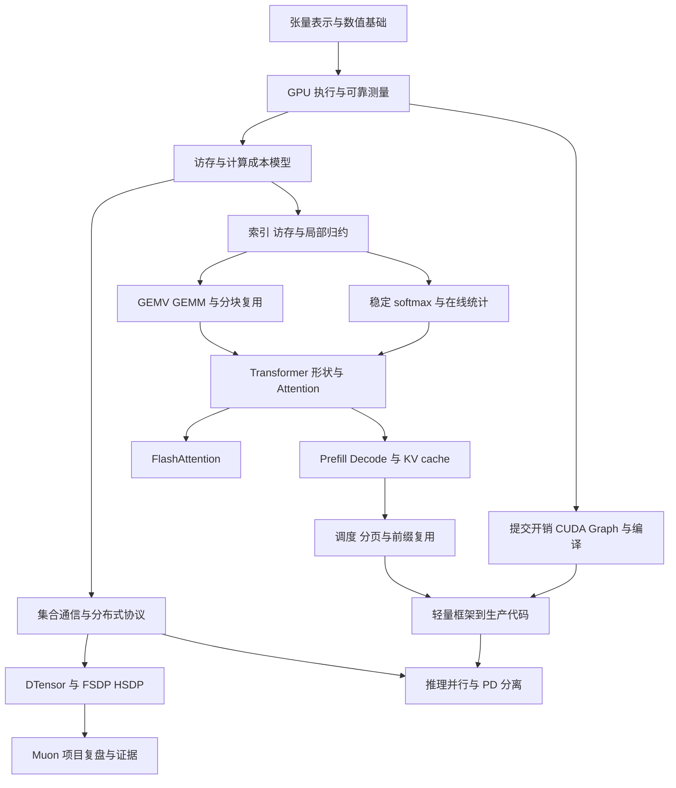

# Infra 学习计划知识脉络版

这份计划面向你已有的 Muon/MuonH 分布式优化器项目，目标是把训练 Infra、GPU 算子和推理系统连成一套能解释、能实现、能验证的知识体系。沿用每周 10–15 小时的时间预算；Muon 算法原理按已掌握处理，只复习系统分析所需的计算单元、形状和成本。

配套文件：[按计划顺序展开的教学文档](C:/Users/highting/Documents/Codex/2026-10-03/codex-threads-01a10065-db54-7b20-9229/outputs/Infra教学文档_从张量到分布式推理.md)，包含公式、手算例子、实验、自测答案和 25 处配图建议。

学习以知识依赖和过关标准推进。约 240 小时是基础与有限范围实验的预算，不代表完成后已掌握所有生产优化。按每周 12 小时约 20 周；实际允许用 20–24 周完成，缺失的编程基础、硬件环境搭建和深入专项另计。

## 知识地图

整条路线反复回答五个问题：数据是什么，放在哪里，由谁计算，什么时候可以使用，性能由什么限制。

图中的分支表示可以独立深入，并不要求同时推进。FlashAttention 的完整实现也不是开始学习推理调度的门槛；理解 Attention 语义、形状和读写成本后，就可以进入 KV 与调度。

对你推荐的实际顺序是：**共同基础 → 通信与训练布局 → 项目复盘 → 基础算子 → 矩阵计算 → Attention → 执行优化 → 推理状态与调度 → 框架 → 分布式推理。** 这样先形成已有项目的解释闭环，再扩展能力。

## 学习深度与时间预算

“讲透”要求独立画数据流、推导成本、说明正确性条件和反例。“实现”要求在明确输入范围下完成正确版本、一个优化版本和性能对照。“认识”要求说明问题、方法、成本和适用条件，暂不承担完整部署。

| 模块 | 核心问题 | 目标深度 | 预算 |
|---|---|---|---:|
| A 张量表示 | 逻辑张量如何对应实际存储 | 讲透并实验 | 16 小时 |
| B 执行与测量 | 工作何时提交、完成和可见 | 讲透并实验 | 16 小时 |
| C 性能模型 | 为什么慢，优化应改变什么 | 讲透并估算 | 16 小时 |
| D 通信协议 | 多个 rank 如何得到一致结果 | 讲透并实验 | 24 小时 |
| E 训练布局与项目 | 谁持有哪些数据，哪里能本地计算 | 讲透并复盘 | 24 小时 |
| F 基础算子 | 线程如何访问和归约数据 | 有限范围实现 | 20 小时 |
| G 矩阵计算 | 复用如何改变计算效率 | 有限范围实现 | 20 小时 |
| H Attention | 如何组合分块乘法与在线统计 | 讲透，完成前向练习 | 20 小时 |
| I 执行优化 | 如何降低分派与提交开销 | 讲透并对照 | 16 小时 |
| J 推理状态与调度 | 请求和 KV 如何随时间变化 | 讲透并模拟 | 20 小时 |
| K 框架阅读 | 原理在哪里变成状态和代码 | 追踪完整路径 | 20 小时 |
| L 分布式推理 | 多设备与多阶段如何协作 | TP 深入，其余分层 | 28 小时 |

预算包含阅读、实验、复述。若 CUDA/C++ 或 Triton 几乎零基础，先补指针、索引、编译、kernel launch、基本语法；F–H 的时间随之延长，不能靠减少正确性验证硬塞进预算。

## 共同基础

### 张量表示与数值基础

**前置：**能写基本 PyTorch 运算，理解矩阵乘法。首先解决“看起来相同的张量，存储和代价是否相同”。

学习顺序：逻辑 shape → `stride` 和 `storage_offset` → view 与复制 → dtype 与字节数 → 别名与原地更新 → 中间结果生命周期。

- 用地址计算理解切片、转置和连续性；区分改变视图与实际搬动元素。
- 判断 `view()`、`reshape()`、`contiguous()`、`clone()` 何时共享存储、何时分配。`reshape()` 不能作为零拷贝的保证。[PyTorch Tensor Views](https://docs.pytorch.org/docs/2.14/tensor_view.html)
- 区分存储精度、运算精度和累加精度；理解 BF16/FP16/FP32、舍入与浮点求和次序。
- 画出输入、输出、中间结果和别名；判断缓冲区何时可以覆盖。

**最小实验：**用一个带坐标值的矩阵做切片、转置、重排和原地修改，记录 shape、stride、偏移、共享关系和元素对应。再对比一段更新的独立中间张量版本与复用版本。

**过关：**给一个非连续张量，能解释地址映射；能证明某次复用不会覆盖仍需读取的数据；能说明“新分配次数下降”与“峰值显存下降”为何是不同证据。

**项目对应：**row shard 接收缓冲区复用、通信前转 BF16、MuonH FP32 缓冲区复用、本地 AdamW 更新。

### GPU 执行与可靠测量

**前置：**A。把 CPU 发起工作、GPU 执行工作、其他执行单元观察到结果分开理解。

学习顺序：host/device → kernel 与 launch → thread/warp/block/grid → SM 与存储层级 → stream/event → 数据依赖与存储生命周期 → 计时。

先掌握寄存器、shared memory、L1/L2、设备显存各自的用途，不要求背架构参数。再画同 stream 和跨 stream 的生产者、消费者关系。跨 stream 的执行依赖与 allocator 的存储复用安全需要分别处理。[PyTorch CUDA semantics](https://docs.pytorch.org/docs/stable/notes/cuda.html)

工具随着问题引入：

| 问题 | 工具与观察对象 |
|---|---|
| 哪个框架操作产生开销 | `torch.profiler`，看算子、shape、CPU 与 GPU 工作 |
| 谁在等待，GPU 为什么有空洞 | `nsys`，看提交、stream、同步和通信时间线 |
| 一个 kernel 内部为什么慢 | `ncu`，看访存、计算、资源与调度 |

**最小实验：**对同一段矩阵运算分别记录 CPU 提交区间、正确同步后的 wall-clock 和 CUDA Event 时间；用时间线解释差异。先只读一份基本报告，后续按模块增加指标。

**过关：**能解释计时边界、预热、首次初始化与稳态；能指出某个优化器区间是否可能包含前序工作的等待；知道硬件指标采集可能扰动执行，性能结论需独立计时。[NCU Profiling Guide](https://docs.nvidia.com/nsight-compute/ProfilingGuide/index.html)

### 访存与计算成本模型

**前置：**A、B。先预测优化应改变的量，再看工具报告。

学习顺序：FLOPs 和字节数 → 数据复用 → 计算强度 → roofline → launch 与小任务开销 → 驻留资源 → 依赖和关键路径。

设指定存储层的传输量为 \(V\)，计算量为 \(F\)，相应带宽为 \(B\)，则：

$$
I=\frac{F}{V},\qquad
P\lesssim\min(P_{\mathrm{peak}},IB).
$$

这是瓶颈分析模型。要明确实际计算精度、存储层和流量口径；算法理想 IO、朴素实现访问量、实测 DRAM 流量分别记录。

按 elementwise → transpose → reduce → GEMV → GEMM 的顺序手算。比较的重点是：谁几乎不复用输入，谁可以靠分块提高复用，谁只是改善访存事务，谁通过融合减少中间读写。

资源指标按需补齐：合并访存与 bank conflict 用转置实验理解；寄存器、occupancy、CTA 驻留和 wave 用 block/tile 扫描理解；SMSP 和 stall 在已有性能假设时查看，不按术语表逐个背诵。

**最小实验：**选一条逐元素链和一次 GEMM，先估计流量与计算量，再比较不同规模的实际结果。解释为什么小输入可能主要受提交开销影响，不能仅凭低计算强度断言带宽已饱和。

**过关：**能区分“计算多”“复用高”“利用率高”；能说明提高 occupancy 不保证加速；能解释局部优化没有缩短端到端关键路径的情形。

## 分布式训练主线

### 集合通信与分布式协议

**前置：**A–C。先理解需要什么数据，再选择通信操作，最后研究通信实现。

学习顺序：进程与 rank → process group 与 SPMD → collective 语义 → 匹配与共同顺序 → 通信成本 → ring 等算法 → 物理拓扑。

| 数据需求 | 应理解的操作 | 项目中的联系 |
|---|---|---|
| 每个 rank 都需要归约结果 | `all_reduce` | 梯度存在性、范数统计量 |
| 每个 rank 都需要各份原始数据 | `all_gather` | 重建完整 NS 输入 |
| 归约后各自保留一个分片 | `reduce_scatter` | 分片梯度 |
| 不同输入发给不同目标 | `all_to_all` | owner 输入派发、结果回传 |
| 数据只汇集到一个目标或从其分发 | gather/scatter 或点对点组合 | 对照 owner 实现方案 |

归约与分发是不同语义。已经算好的结果切片，不应只因为要“scatter”就增加一次归约。[NCCL collective 语义](https://docs.nvidia.com/deeplearning/nccl/user-guide/docs/usage/collectives.html)

协议重点：所有参与者如何确定参数顺序；部分 rank 没有梯度时怎样保持共同通信路径；变长 split、空 shard 和 padding 如何表示；CPU API 返回与 GPU 使用结果之间还有哪些依赖。

成本从 \(T\approx n\alpha+V/B_{\mathrm{eff}}\) 入手，分别考虑启动次数、数据量、打包、等待和重叠。随后再学 PCIe、NVLink、RDMA、InfiniBand/RoCE、NIC 与 GPU 拓扑；比较带宽时统一 bit/byte、单向/双向和聚合口径。

**最小实验：**三 rank 坐标矩阵收集与变长派发；为全有、全无、部分缺失梯度列出共同调用序列；手推 ring all-reduce 的分块流动。协议可先用 CPU/Gloo 验证，NCCL 性能另在 GPU 上测量。

**过关：**能给每条数据标明来源和目的；能指出一个协议的失配位置；能解释调用次数、逻辑 payload、链路流量和耗时不能互相替代。

### DTensor 与训练状态的布局

**前置：**D、A。先建立全局数据和本地数据的对应，再学习框架生命周期。

学习顺序：`DeviceMesh` → `Shard`/`Replicate`/`Partial` → global/local shape 与 offset → 布局传播和重分布 → DDP → 状态分片思路 → FSDP → HSDP。

`Partial` 是需要归约的局部贡献，不能当作互不重叠的普通分片。遇到本地计算，先判断操作是否保留全局语义，再考虑绕过分派。[DTensor 文档](https://docs.pytorch.org/docs/2.14/distributed.tensor.html)

沿一次训练迭代检查参数、梯度、优化器状态和激活：各自何时存在、在哪里存在、是否复制、何时通信。只用状态分片的基本思路对照 ZeRO，不新增完整框架专项。项目采用 FSDP1 还是 FSDP2，需要依据实际代码确认。

**最小实验：**画一个二维 mesh；标出每个 rank 持有的元素与副本；分别画前向、反向和 optimizer 阶段。对同一逻辑矩阵比较 shard、replicate 和 partial 下范数的求法。

**过关：**能判断本地数据是否构成原算法的完整计算单元；能区分 HSDP 的分片组与复制组；能说明本地平方后归约对哪种布局成立、对哪种布局不成立。

### 用现有项目完成第一次综合验收

这部分计入 E，不等全部路线学完才做。沿“梯度和动量 → 完整计算单元 → NS → 候选权重 → 回缩 → 写回”的实际代码，补齐每一阶段的布局、通信与生命周期。

| 简历内容 | 需要连起来的知识 | 必须说明的边界 |
|---|---|---|
| 元数据缓存与标记合并 | 稳定布局、缓存失效、共同协议、小消息成本 | 参数/mesh 变化，多个 group 是否能合并 |
| 通信前转 BF16 | dtype、通信量、转换位置 | 两条路径转换的是不是相同元素，中间是否有运算 |
| 连续 row shard 复用接收区 | 地址布局、拼接顺序、别名 | 非连续、列分片、padding、不等长情况 |
| 完整本地块直接更新 | 全局语义与计算单元 | 不能擅自把整矩阵算法改成分块算法 |
| 分片回缩 | 局部平方和、全局统计、数值次序 | 重复副本、padding、逐 head 统计和真实回缩公式 |
| NS owner 分配 | 成本估计、负载均衡、批量通信 | 最慢 owner、临时显存和打包开销 |
| 只回传所需结果分片 | 后续数据需求、回缩依赖 | 后续仍需完整结果时不能直接删除回传 |
| FP32 缓冲区复用 | 别名、最后使用位置、异步生命周期 | 分配计数不能代替峰值显存 |
| AdamW 本地 fallback | 逐元素语义、状态布局、分派开销 | 布局不匹配与 CPU/GPU 瓶颈变化 |

Muon 原理不重学；只复核 NS 的矩阵形状、每轮主要矩阵乘成本，以及 owner 为什么不能只按矩阵个数或元素数均分。

每个已有数字建立证据卡：配置、对照路径、计时或计数边界、原始证据、能支持的结论。原聊天中的数字是项目描述，本计划没有重新执行实验或核验源码。缺失的代码、日志和多卡结果标为待补。

**阶段过关：**脱稿解释一次完整更新；选一个快路径给出成立条件和反例；解释一项优化的新增成本；把一条简历数字对应到明确实验。

## 单卡算子主线

### 从访存映射到归约和 softmax

**前置：**A–C；不依赖先完成分布式路线。按能力依赖学习，而非把算子名称并排记忆。

| 练习顺序 | 新增能力 | 实现范围 |
|---|---|---|
| elementwise | 全局索引、边界 mask、逐元素融合 | 独立运算与短链融合 |
| transpose | 读写合并、shared memory 重排 | naive → tiled → 明确条件下的 bank conflict 优化 |
| reduce | 线程协作、shuffle、block 同步 | 单 block → 两阶段求和 |
| softmax | 稳定 max、exp、sum、归一化 | 单行/单 block → 融合实现 |

**统一实验：**每个算子只保留一个朴素版本和一至两个有明确目的的优化版本。覆盖非整块尺寸和不同规模，记录结果误差、读写量、时间及与改动直接相关的指标。

**过关：**能手画一个 warp 的地址；解释 reduce 的跨线程依赖；说明 softmax 为什么减去最大值；从报告提出下一次只改变一个因素的实验。

局部 reduce 与跨 rank `all_reduce` 在这里连接起来：前者生成本地统计量，后者组合多个设备的统计量。它们的执行机制和成本不同。

### 从 GEMV 到 GEMM 和 Triton 分块

**前置：**F、C。GEMV 延续点积和归约，GEMM 引入多输出之间的输入复用。

先写有限布局下的 CUDA GEMV，对比每线程一行与 warp 协作；再用小例子解释为什么多个向量合并成矩阵后能复用权重。

进入 Triton 时补齐 `program_id`、offset、mask、`tl.load/store` 和 `tl.dot`，然后学习输出 tile、K 方向循环、累加精度、tile 参数和有限配置搜索。CUDA block 与 Triton program 不按简单逐项替换来理解，重点追踪一个 program 处理哪些数据。

对 \(A\in\mathbb{R}^{M\times K}\)、\(B\in\mathbb{R}^{K\times N}\)，输出为 \(M\times N\)，主要计算量为 \(2MKN\)。分别写算法理想 IO 与 tile 访问模型，解释寄存器压力、shared memory 和 L2 复用为什么改变实际表现。

**最小实验：**一个大方阵、一个长矩形、一个小矩阵；改变两三组 tile，比较结果与性能。参考 [Triton GEMM 教程](https://triton-lang.org/main/getting-started/tutorials/03-matrix-multiplication.html)。

**过关：**能讲清 A/B 在 tile 内如何复用；能解释大 tile 的收益与资源代价；能说明某组 shape 的性能不能外推到所有 GEMM。

### Transformer 形状到 FlashAttention

**前置：**softmax、GEMM。先补模型数据流，再进入融合算子。

先画 Transformer block 中投影、Attention、MLP、残差和归一化的输入输出；理解 RoPE、causal mask、MHA/GQA/MQA 在数据形状中的位置。这里只补 Infra 所需部分，不展开模型训练理论。

单 head 中，设 \(Q\) 为 \(N_q\times d\)，\(K,V\) 为 \(N_k\times d\)，则 \(QK^\top\) 得到 \(N_q\times N_k\)，行 softmax 后乘 \(V\)，得到 \(N_q\times d\)。先把普通实现的中间读写画出来。

再依次学习：稳定 softmax → 分块统计的合并 → 在线维护最大值与指数和 → 同步修正输出累加器 → Q/K/V 分块 → causal 边界 → FA2 工作划分。

FA1 的核心学习目标是理解 IO 感知的分块与中间矩阵存储减少；FA2 再研究非矩阵乘工作的减少和线程块、warp 间工作划分。[FA1 论文](https://arxiv.org/abs/2205.14135)、[FA2 论文](https://arxiv.org/abs/2307.08691)

**最小实验：**先手算两个 tile 的统计合并，再参考 [Triton fused attention](https://triton-lang.org/main/getting-started/tutorials/06-fused-attention.html) 完成限定 dtype、head dimension 和布局的前向。先非 causal，再 causal；反向和架构专用调优另列专项。

**过关：**能解释为何各 tile 单独 softmax 后不能拼接；能指出没有落显存的中间数据；能说明 FA2 的改动发生在哪种工作划分。能复述算法但无法独立实现时，记录为“原理通过，实现待补”。

## 从执行开销到推理系统

### CUDA Graph 与编译优化

**前置：**B 和 elementwise 融合实验。可在 F 后学习，无需等全部 Attention 实验完成。

学习顺序：Python/框架分派 → kernel launch → 小 kernel 链 → 手动融合 → 图捕获和编译 → CUDA Graph capture/replay。

比较三类改变：本地 fallback 减少某些框架分派；融合减少 kernel 和中间 IO；CUDA Graph 重放降低重复提交开销。`torch.compile` 与 CUDA Graph 可以组合，但职责不同。

编译链先掌握 TorchDynamo、训练相关的 AOTAutograd、TorchInductor，以及 graph break、shape guard 和重编译。CUDA Graph 先掌握稳定地址、捕获范围和动态形状的组织问题。[PyTorch compiler](https://docs.pytorch.org/docs/stable/torch.compiler.html)、[CUDA Graph 说明](https://docs.pytorch.org/docs/stable/notes/cuda.html#cuda-graphs)

**最小实验：**在适用的固定形状更新块上比较 eager、融合、compile、graph；分开首次编译/捕获与稳态时间。

**过关：**看到 kernel 间空洞或大量小 kernel，能提出不同假设并设计对照；能解释 CPU 开销下降为什么未必带来同等 GPU 加速。

### Prefill Decode 与 KV 生命周期

**前置：**Transformer 形状、C；FA 完整实现不是硬前置。

学习顺序：自回归生成 → prefill/decode 的输入形状 → KV 为什么可复用 → KV 如何增长 → batch 与长度变化 → 服务指标。

分别分析线性投影/MLP 和 Attention。投影在低 batch decode 时权重复用较弱；Attention 还需要访问历史 KV。用具体 shape 判断瓶颈，不把 prefill 和 decode 永久贴成 compute-bound 与 memory-bound。

设层数为 \(L\)，请求历史长度为 \(S\)，KV head 数为 \(H_{\mathrm{KV}}\)，head dimension 为 \(d\)，每元素为 \(s\) 字节，则未计 padding、共享与分片时：

$$
V_{\mathrm{KV}}=2LSH_{\mathrm{KV}}ds.
$$

同时区分 TTFT、ITL/TPOT 和吞吐；使用相同请求分布、到达方式及测量边界比较策略。

接着按问题引入调度与存储：请求长度不齐 → continuous batching；KV 连续分配与容量利用 → 分页和 block table；重复前缀 → prefix caching；长 prefill 占用执行时间 → chunked prefill。

前缀命中主要复用已计算的前缀，后续 decode 仍需执行。学 RadixAttention/Radix Cache 时追踪前缀匹配、引用和回收，不能只记树结构名称。[vLLM prefix caching](https://docs.vllm.ai/en/latest/features/automatic_prefix_caching/)

**最小实验：**用少量长短请求画调度表，追踪 waiting/running/finished、token budget、KV 分配和释放；加入共享前缀后，标注命中、省略的计算和仍需执行的计算。

**过关：**能从一次请求进入讲到资源回收；能解释扩大 batch 的复用收益和 KV/时延成本；能区分分页、前缀复用和调度分别管理什么。

### 从轻量框架到生产代码

**前置：**J；读执行部分时使用 I。先有原理问题，再用代码确认机制。

选择 Nano-vLLM 或 Mini-SGLang 中一个固定 commit。阅读顺序为请求状态 → scheduler → cache/block manager → model runner → attention/KV 写入 → sampling → 结束与回收。

轻量框架的任务是建立全局调用图。随后只在一个生产框架里追三条路径：token budget 与 batch 构造；前缀命中、引用和淘汰；模型执行与 KV 管理的连接。框架版本若改变模块名，按符号和状态定位。

**产物：**一张请求状态图、一个带源码位置的调用序列、三份特性阅读卡。每份卡写明 commit、入口、关键对象、状态变化、数据去向和一个测试/日志入口。

**过关：**能回答“哪个对象决定谁执行，哪个对象决定 KV 放哪里，哪个模块真正执行”；能把一个原理对应到状态变更和数据结构，而非只列出文件名。

### 分布式推理与后续专项

**前置：**D、G、J、K。沿“切什么数据，会产生什么通信，收益是否覆盖成本”学习。

优先深入 TP：线性层行列切分 → 局部输出 → collective → Attention head/KV 布局 → prefill/decode 下不同的计算通信比例。做一个小矩阵等价性实验，并画通信图。

PP、EP、CP 先做到可解释：PP 关注 stage 与流水气泡；EP 关注 token 派发、合并与负载；CP 关注上下文和 KV 工作的切分。DCP、PCP、DP attention 按所选框架的具体定义定位，暂不要求全部实现。

PD 分离在本地调度问题之后学习：为什么分开资源 → KV 由谁产生和消费 → 传输什么布局 → 路由和排队 → 成本是否被收益覆盖。先估计 \(V_{\mathrm{transfer}}/B_{\mathrm{effective}}\)，再考虑启动、同步、转换和重叠。

speculative decoding 是另一条分支：draft → 多 token verify → 接受/拒绝 → KV 提交或回退。认识它如何改变计算粒度；若需讲透，进一步推导接受规则与目标分布的关系，不能只用接受率判断加速。

**最小实验：**TP 做数值对照；chunked prefill 做调度对照；PD 做字节量和时延模型；speculation 做接受长度、draft 成本与总耗时分析。主线不要求部署完整 PD 系统。

Mooncake、LMCache、Dynamo 在此后按“数据搬运、缓存管理、路由与服务协作”选择一个追踪；职责可能重叠，应以固定版本为准。NVSHMEM/symmetric memory 在通信同步基础牢固后再学；TensorRT/TensorRT-LLM 在图优化与推理执行基础上再学。这些保留为专项，不计入主线必须完整实现的范围。

**最终过关：**给定模型、请求长度分布、GPU 数和网络条件，能提出一个并行/调度方案，说明瓶颈、代价和需要验证的假设。

## 如何学得牢

每个知识点走四步：先用自己的话定义，再画数据流或形状变化，随后做能区分两种解释的实验，最后回答一个反例。学习记录以这四项为核心，不以摘录量为指标。

每周约 12 小时可以分为阅读推导 3 小时、实验 5 小时、性能解释 2 小时、复述复习 2 小时。实验耗时超出预算时顺延，不同时铺开多个没有结论的实现。

复习在三个时点发生：模块结束时脱稿解释；下一周换一个 shape 或布局重做判断；跨主题再次遇到同一原理时迁移应用。

| 已学原理 | 第一次应用 | 再次迁移 |
|---|---|---|
| 存储别名与生命周期 | 更新 buffer 复用 | CUDA Graph 地址与 KV 回收 |
| 归约与统计量 | 局部 reduce | MuonH 分片范数、在线 softmax |
| 数据复用与 IO | GEMM tile | decode batching、Attention 融合 |
| 全局与本地语义 | DTensor/HSDP | TP、CP 和 KV 分片 |
| 调度与负载均衡 | NS owner | 请求调度、EP 和 PD worker |
| 关键路径与证据 | 优化器消融 | kernel 优化与服务时延 |

“再次迁移”表示复用分析方法，不表示这些算法可以直接互换。例如在线 softmax 需要额外统计修正，不能照搬范数求和。

设置四次验收：E 后解释训练项目；H 后解释基础算子到 Attention；K 后追踪请求与 KV；L 后讨论系统取舍。面试准备贯穿这些验收，最后只整理表达和证据。

没有合适 GPU 时，完成手算、CPU 协议实验、状态模拟与源码阅读；GPU 性能项保留“待实测”。任何环境下都区分“读懂、实现、测量、能解释”，避免用一个完成勾选掩盖缺口。

## 后续学习 HTML 的组织方式

一级导航沿用共同基础、分布式训练、单卡算子、推理系统。模块内部拆成单一概念，例如 `stride`、跨 stream 依赖、`Partial`、分片范数、在线 softmax，每页明确前置节点。

每页包含：核心问题、前置知识、讲解与形状图、最小例子、实验任务、自测题与答案、项目联系、参考来源。进度分别记录“理解、实现、验证、复述”；不适用的实现任务明确标注。

从项目条目跳到知识点，也能从知识点返回项目证据。例如“分片回缩”链接到布局、局部归约、通信组和浮点误差；“owner 回传”链接到数据依赖、结果分片和负载成本。这样后续 HTML 可以用于学习，也可以用于面试前按项目反查。

## 资料使用原则

每个模块只选一份主资料，必要时补一份论文或官方教程。先按本模块的问题阅读，不通读整套文档。API 与实现按本机版本或固定 commit 核对，本文引用的在线文档不代替版本确认。

原计划中的公式表、NCU 指标阅读表和项目讲义仍可作为查阅资料。本版负责组织先后关系、学习深度和验收，不要求重复整理已有正确内容。
